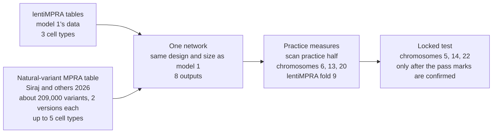

# small-regulatory-dna-model-v2

**Model 2, the "more data" route. Locked test passed (16 Nov 2026); weights not yet released.** This repository continues [small-regulatory-dna-model](https://github.com/paulsagar7796-cmyk/small-regulatory-dna-model) (model 1), the lab's released 1.3M-parameter model of regulatory DNA activity.

From [PurvoLabs](https://github.com/PurvoLabs).

## Result of the locked test (run once, 16 Nov 2026)

Chromosomes 5, 14, 22, 29,397 variants. Pearson correlation between measured and predicted effect of a single-letter variant, mean of HepG2 and K562:

| Model | Mean | HepG2 | K562 |
|---|---|---|---|
| **Model 2** | **0.594** (seed 2: 0.592) | 0.632 | 0.555 |
| Model 1 (released) | 0.508 (seed 2: 0.508) | 0.543 | 0.472 |
| Published MPRA-LegNet | 0.466 | 0.487 | 0.444 |
| 6-letter-word baseline | 0.319 | 0.349 | 0.290 |

Gain over model 1: **0.086 (95% interval 0.074 to 0.099)**. All four pass marks, confirmed before the test, are met. Full report with limits: [results/locked/REPORT.md](results/locked/REPORT.md). The locked chromosomes are now closed.

**Correction (16 Nov 2026).** A flaw in the leak guard left near-copies of 3,277 of the 29,397 locked variants in the training table. Re-scored once on the variants without a near-copy (5,259 HepG2 / 5,389 K562), model 2 scores **0.590** (seed 2: 0.588) against model 1 0.510, published MPRA-LegNet 0.468 and the baseline 0.319. Gain over model 1: **0.080 (95% interval 0.068 to 0.094)**; all four pass marks still hold. The numbers above stay the test result of record; this is a post hoc correction. Details: [results/locked/REPORT.md](results/locked/REPORT.md#correction-2026-11-16-near-copies-in-training).

## Why a second model

Model 1 was trained on one public dataset (lentiMPRA, three cell types). After it was released we tried to push it further without new data, and every route was used up:

| What we tried on model 1 | Outcome |
|---|---|
| Changes to the network design (five of them) | No gain |
| A 1.5 times wider network | Small gain on whole pieces only |
| A second round of learning from our own trained models | No gain |
| Averaging our four best models | +0.007 on single-letter changes, not clearly above zero |

All those models learned from the same data, so they share the same mistakes. The remaining route is **new training data**.

## The plan

- **Same network, more data.** The design and size of model 1, with five extra outputs for the new table's cell types (HepG2, K562, SK-N-SH, HCT116, A549).
- **Why this table.** It holds about 280,000 single-letter variants, each measured as a pair: the piece with one letter, and the piece with the other. Model 1 never trained on a measured single-letter pair.
- **A control run** trains on the lentiMPRA data alone with the same pieces removed, so the effect of the new data can be read cleanly.

## The split (fixed before any model was trained on the new table)

| Part | Chromosomes | Variants | Use |
|---|---|---|---|
| Training | all others | 208,783 | Training |
| Practice | 6, 13, 20 | 28,104 | Every choice |
| Locked | 5, 14, 22 | 29,397 | One test, run on 16 Nov 2026 after the marks were confirmed and the model was fixed. Now closed |

Leak guards remove pieces that are the same DNA across parts, and everything next to model 1's single-letter test pieces. Details and counts: `src/prepare_more_data.py`, `results/split_counts.json`.

## What model 2 has to beat (practice chromosomes 6, 13, 20; practice numbers, not test results)

Pearson correlation between measured and predicted effect of a single-letter variant, over variants where at least one version is active, mean of HepG2 and K562:

| Model | Effect of the variant | Activity of the pieces |
|---|---|---|
| Model 1 (released) | 0.491 (seed 2: 0.484) | 0.610 |
| Published MPRA-LegNet | 0.455 | 0.584 |
| 6-letter-word baseline | 0.313 | 0.407 |

On model 1's other practice measure (the saturation scan's practice half) model 1 scores 0.627.

## First practice result (one seed)

Pearson correlation, practice data only, one seed (20261113). Not test results.

| Model | Scan practice half | Natural variants (chr 6, 13, 20) | lentiMPRA fold 9 |
|---|---|---|---|
| Model 1 (released) | 0.627 | 0.491 | 0.842 |
| Control (lentiMPRA only, same removals) | 0.595 | 0.473 | 0.824 |
| Model 2, new outputs | 0.687 | 0.573 | 0.829 |

The new data clearly improves single-letter accuracy on both practice measures, with intervals of the difference from model 1 above zero. Whole-piece accuracy on lentiMPRA was slightly below model 1 before the self-distillation step; after it, model 2 scores 0.844 on fold 9 (seed 2: 0.840). Part of the gain may come from training on the same laboratory's assay. Full record: [results/PRACTICE_RUN_1.md](results/PRACTICE_RUN_1.md).

## Status

| Step | Status |
|---|---|
| Split and leak guards | Done, 14 Nov 2026 |
| Pre-declaration ([predeclarations/PREDECLARATION_MORE_DATA.md](predeclarations/PREDECLARATION_MORE_DATA.md)) | CONFIRMED, 15 Nov 2026 (gain mark raised by the maintainer from 0.03 to 0.06) |
| Reference numbers for model 1 on the practice chromosomes | Done (table above) |
| First practice runs: model 2 and the control | Done, 14 Nov 2026 ([results/PRACTICE_RUN_1.md](results/PRACTICE_RUN_1.md)) |
| Second and third seeds of model 2 | Done, 15 Nov 2026 |
| Read-out (new outputs) and self-teaching step chosen on practice data; model fixed | Done, 15 Nov 2026 |
| Locked test | **Done, 16 Nov 2026: PASS on all four marks** ([results/locked/REPORT.md](results/locked/REPORT.md)) |
| Release of model 2 weights | To do |

## Honest framing, decided in advance

Model 2 passed, so the claim is **"a better small model with more data"**. It is not a same-data comparison: model 2 has seen the test's assay and laboratory during training, and model 1 and the published model have not. Other groups have trained models on this family of data (Malinois, MPAC); we have not run them and make no claim against them.

The leak guard missed some near-copies in repeated DNA; the locked result corrected for this is 0.590, gain 0.080 (see the correction above). The MPAC comparison and the scan practice numbers were not corrected.

## Layout

| Path | What |
|---|---|
| `src/prepare_more_data.py` | The split and the leak guards |
| `src/train_more_data.py` | Trains model 2 (and the control with `--new_cells none`) |
| `src/evaluate_practice.py` | Scores a run on practice data beside model 1 and the published model |
| `predeclarations/` | The confirmed rules for the locked test |
| `src/evaluate_locked.py` | The locked test (run once) |
| `results/` | Result files as they are produced |
| other files in `src/` | Model 1's code, which model 2 builds on |

Model 1's weights are read through a local link (`released_weights`) to the first repository's `weights/` folder. Data sources: [DATA.md](DATA.md).

## Safety, maintainer, licence

This model scores DNA. It does not generate DNA. **Maintainer:** [ORCID 0009-0007-7020-8949](https://orcid.org/0009-0007-7020-8949). **Licence:** not chosen yet; `src/third_party/legnet_model.py` stays under its MIT licence. The code and text were produced with an AI coding assistant (Claude), directed and checked by the maintainer.
